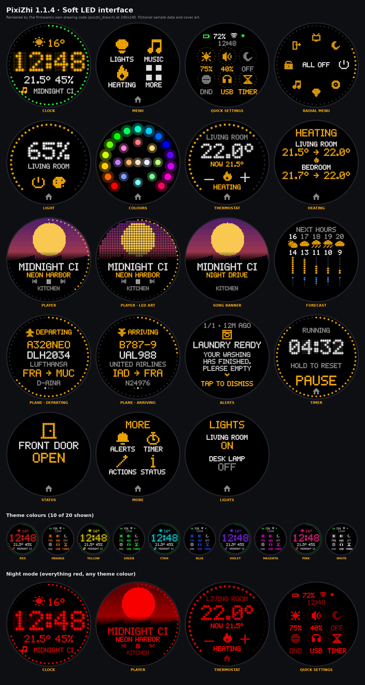

# PixiZhi SpotPear

**0.9.9 · ESPHome firmware and Home Assistant blueprints for the Spotpear Ball v2**

A bold pixel interface for a small round desktop display: clock, home controls,
music, thermostats, status, notifications, timer, and four quick actions.
Configure your entities in Home Assistant rather than hardcoding them in firmware.



*Firmware drawing-code previews with fictional sample entities. Night images show
red pixel colours; the physical brightness setting is not simulated.*

## Features

- Pixel clock with weather/status rotation, temperature/humidity, and optional
  playing-track information. No alternate smooth clock or clock-style selector.
- Up to six favourite light, switch, media-player, or thermostat controls.
  Larger category lists scroll vertically and show a V hint when more are below.
- Touch controls and rim gestures for brightness, volume, and temperature.
- Red night interface on every page, scheduled start/end times, and an independent
  saved Night Mode Brightness. Schedules crossing midnight are supported.
- Pixel notifications, an adjustable kitchen timer, and four directional quick
  actions (the pizza menu).
- Sendspin playback with paired-server authentication and a six-digit pairing
  screen. Existing trust is stored across restarts.
- Internal ES8311 speaker or USB UAC 1.0 DAC output, manual selection, and optional
  fallback to the internal speaker.
- USB software volume/mute to avoid sending hardware volume controls that can
  stall some DACs. Native stereo is preserved; mono sounds are duplicated to L/R.
- Three included Home Assistant blueprints: screens/controls, display notifications,
  and notification-LED flashes.

## Requirements

- **Spotpear Ball v2 hardware matching this pinout:** ESP32-S3, 16 MB flash,
  8 MB octal PSRAM, 240×240 GC9A01A display, CST816 touch, ES8311 audio.
- **ESPHome 2026.11.0-dev with ESP-IDF.** This configuration depends on development
  components and is not intended for older stable ESPHome releases.
- Home Assistant with its ESPHome integration. Enable **Allow the device to
  perform Home Assistant actions** for the configured device.
- A compatible Sendspin server for local music playback. The current ESPHome
  implementation uses Sendspin 1.0.0-rc1 (for example Music Assistant 2.11.0b4+).

The ESP32-S3 does not support Bluetooth Classic/A2DP audio reception. This firmware
is not a Bluetooth music receiver, and BLE proxy functionality is disabled.
USB audio requires a compatible **UAC 1.0** device and a working host power/data
connection. A higher-power DAC or a different board may need additional hardware.

## Install

1. Copy `pixizhi.yaml`, `pixizhi_ui.h`, `components/`, `fonts/`, and `sounds/` together into your
   ESPHome configuration directory. Keep their relative paths intact.
2. Copy `secrets.yaml.example` to `secrets.yaml`. Fill in your Wi-Fi credentials,
   a unique fallback-AP password (at least eight characters), and OTA password.
   Generate an API encryption key with `openssl rand -base64 32` and put it in
   `api_encryption_key`. The example deliberately contains no usable credentials.
3. In `pixizhi.yaml`, set the device name/friendly name if desired, and set the
   `timezone` substitution. The public default is **Etc/UTC**, not a location
   selected for a particular household.
4. Validate and install with your ESPHome development add-on, or run:

   ```sh
   esphome config pixizhi.yaml
   esphome run pixizhi.yaml
   ```

   For an existing device, use its current OTA address/password when targeting
   the first update. This template contains no hardcoded network address.
5. Add the device to Home Assistant using the API encryption key, and enable
   permission for the device to perform Home Assistant actions.
6. Import the three YAMLs in `blueprints/` into Home Assistant. Create an
   automation from each blueprint you need. In the screens blueprint, choose
   your own entities; no household sensor, player, or weather entity is prefilled.
7. Keep the blueprint's **ESPHome device name** equal to the firmware name
   (`pixizhi` by default). For names containing dashes, HA service names use
   underscores; see [configuration notes](docs/CONFIGURATION.md).

No prebuilt firmware is supplied: compile with your own secrets. Do not commit
`secrets.yaml`, local build output, or configured device exports.

## Use

- Tap the clock for the four-category launcher. A single configured light/player
  opens its controls directly; multiple entities open a list.
- Swipe up/down through category lists, or tap V for more. The home icon returns
  to the clock. On regular control pages, centre swipes navigate or go back.
- Turn the outer rim on the clock for brightness, on music controls for volume,
  and on thermostats for target temperature. Keep navigation swipes in the centre.
- Notifications: swipe vertically through a long message, tap to dismiss a normal
  alert, or hold for one second to dismiss an urgent alert.
- Timer: tap −/+ to set minutes, then START. PAUSE/RESUME controls playback of the
  countdown; hold the main button to reset. Home closes the page, not the timer.
- The four pizza directions invoke the four configured Home Assistant actions.
- Enable **Night Mode** to use its schedule. Start is inclusive, end is exclusive;
  equal times disable the interval. **Night Mode Brightness** defaults to 10%.
  The clock rim adjusts that value at night; daytime brightness is retained.

See [configuration](docs/CONFIGURATION.md), [audio and pairing](docs/AUDIO.md),
and [validation notes](docs/VALIDATION.md).

## Development status

The `dev` branch is experimental and is the current development branch.


This is an early **0.9.9** source release. The 0.9.9 additions compile with
ESPHome 2026.11.0-dev and pass host tests of the shared helpers, but have not yet
been exercised on hardware (deep-standby touch wake in particular).

The 0.9.8 base is described below. USB software volume was tested
successfully on compatible hardware. The pixel interface passed full development
firmware compilation and host checks of rendering, scheduling, and brightness.
The complete 0.9.8 interface/authentication combination still needs on-device
verification of touch behaviour, PWM brightness, and sustained playback.

## Credits and licensing

Hardware definitions are based on
[RealDeco/xiaozhi-esphome](https://github.com/RealDeco/xiaozhi-esphome).
The project builds on [ESPHome](https://github.com/esphome/esphome), LVGL,
ESP-IDF, and Sendspin. The bundled USB component is an ESPHome development
snapshot with a local software-volume patch; see its [patch notes](components/usb_audio/PATCH.md).

Project-authored configuration, blueprints, documentation, pixel font, and
synthesized sounds are GPLv3-licensed. Bundled third-party files retain their
licenses, including **GPLv3 for the ESPHome USB C++ runtime** and MIT for its
Python code. See [LICENSE](LICENSE) and [third-party notices](THIRD_PARTY.md).
